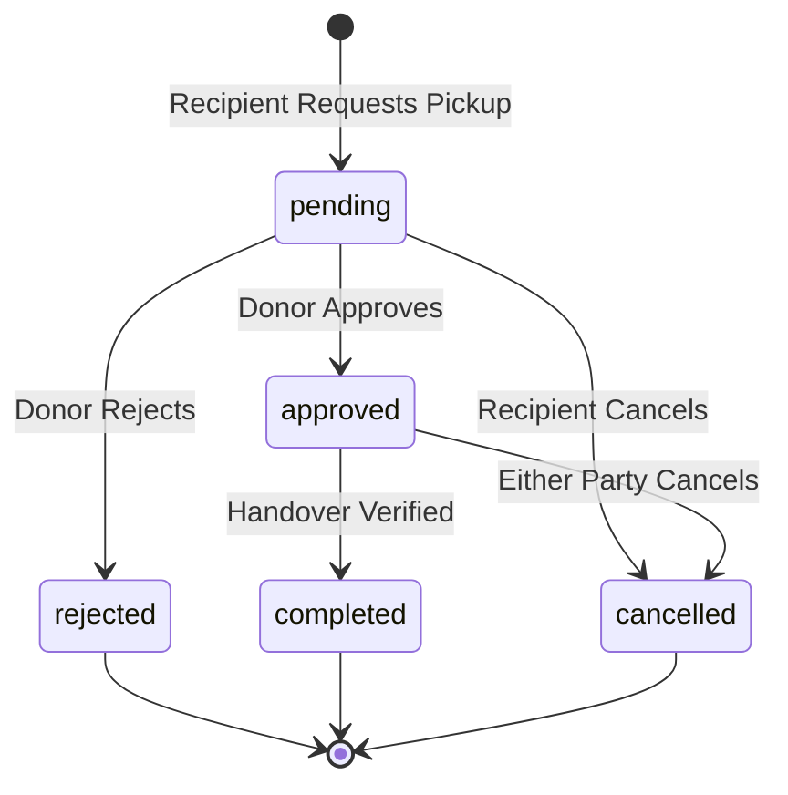

# FoodBridge — Technical Architecture & Documentation

This document provides a concise architectural reference for the **FoodBridge** platform, suitable for technical reviews, project viva examinations, and deployment audits.

---

## 1. Database Architecture (MongoDB / Mongoose)

### 1.1 User Model (`models/User.ts`)
Stores accounts for both food donors and community relief recipients.

| Field | Type | Required | Description |
| :--- | :--- | :--- | :--- |
| `name` | String | Yes | Full name or representative name |
| `email` | String | Yes (Unique) | Contact email used for authentication |
| `phone` | String | Yes | Contact telephone number |
| `passwordHash` | String | Yes | `bcryptjs`-hashed password (10 salt rounds) |
| `role` | String | Yes | Enum: `'donor'`, `'recipient'`, `'admin'` |
| `organization` | String | No | Business, kitchen, or shelter name |
| `address` | String | No | Physical address or locality |
| `bio` | String | No | Organization summary / description |
| `isDemo` | Boolean | No | Flags seed accounts for safe reset |

### 1.2 Donation Model (`models/Donation.ts`)
Tracks surplus food batches made available for community rescue.

| Field | Type | Required | Description |
| :--- | :--- | :--- | :--- |
| `donor` | ObjectId (Ref: User) | Yes | Reference to donating user |
| `foodName` | String | Yes | Name of food item or meal batch |
| `category` | String | Yes | Category (e.g. 'Cooked Meals', 'Dairy & Eggs', etc.) |
| `quantity` | Number | Yes | Total original quantity |
| `availableQuantity` | Number | Yes | Remaining unreserved quantity |
| `reservedQuantity` | Number | Yes | Quantity currently allocated to pending/approved pickups |
| `unit` | String | Yes | Enum: `'kg'`, `'portions'`, `'boxes'`, `'items'`, `'litres'` |
| `prepDate` | Date | Yes | Timestamp when food was prepared |
| `expiryDate` | Date | Yes | Timestamp after which food is considered unsafe |
| `location` | Embedded Document | Yes | Address, locality, city, and GPS coordinates `{ latitude, longitude }` |
| `imageUrl` | String | No | Food photo URL or placeholder |
| `dietaryInfo` | [String] | No | Dietary tags (e.g. Vegetarian, Halal, Gluten-Free) |
| `status` | String | Yes | Enum: `'available'`, `'reserved'`, `'completed'`, `'expired'`, `'cancelled'` |
| `isDemo` | Boolean | No | Identifies seed entries |

### 1.3 Pickup Model (`models/Pickup.ts`)
Coordinates food handovers between recipients and donors.

| Field | Type | Required | Description |
| :--- | :--- | :--- | :--- |
| `donation` | ObjectId (Ref: Donation) | Yes | Target food donation |
| `recipient` | ObjectId (Ref: User) | Yes | Requesting community recipient |
| `donor` | ObjectId (Ref: User) | Yes | Donating user |
| `requestedQuantity` | Number | Yes | Portions/units requested |
| `status` | String | Yes | State machine enum: `'pending'`, `'approved'`, `'completed'`, `'cancelled'`, `'rejected'` |
| `preferredDate` | String | No | Handover date |
| `preferredTime` | String | No | Handover time |
| `requestedPickupTime` | Date | No | Combined ISO handover timestamp |
| `notes` | String | No | Instructions, vehicle notes, arrival window |

---

## 2. API Endpoint Specification

All endpoints are prefixed with `/api`. Protected routes require a Bearer token in the `Authorization` header: `Authorization: Bearer <jwt_token>`.

### Authentication (`/api/auth`)
- `POST /register`: Register a new donor or recipient account.
- `POST /login`: Authenticate and receive a JWT session token.
- `GET /me`: Retrieve profile of currently authenticated user.
- `PUT /profile`: Update name, phone, organization, address, and bio.
- `PUT /password`: Update user password with current password verification.

### Donations (`/api/donations`)
- `GET /`: Retrieve available surplus food with optional category, urgency, and query filters.
- `GET /:id`: Retrieve detailed information for a single donation item.
- `GET /user/my`: Retrieve all donations created by the logged-in donor.
- `POST /`: Create a new surplus food donation (requires `donor` role).
- `PUT /:id`: Update an active food donation (owner only).
- `DELETE /:id`: Cancel/delete an active food donation (owner only).

### Pickups (`/api/pickups`)
- `GET /`: List all pickup requests involving the authenticated user (as donor or recipient).
- `GET /:id`: Retrieve detailed status of a specific pickup request.
- `POST /`: Submit a pickup request for an available food donation.
- `PATCH /:id/status`: Update pickup status (`approved`, `rejected`, `completed`, `cancelled`).

### Expiry Engine & Diagnostics (`/api/expiry`, `/api/health`, `/api/dashboard`)
- `POST /api/expiry/calculate`: Calculate remaining shelf-life, expiry status, and urgency metrics.
- `POST /api/expiry/estimate`: Compute shelf-life estimates based on temperature conditions.
- `GET /api/dashboard/stats`: Retrieve role-specific metrics (active food, pickups, meals saved).
- `GET /api/health`: Diagnostic health check returning server uptime, Node version, and MongoDB connection status.
- `POST /api/seed`: Idempotently seeds demo donors, recipients, and food donations.

---

## 3. Pickup State Machine & Inventory Invariant

The pickup lifecycle guarantees that food inventory is never over-allocated:

### Invariants:
1. `availableQuantity + reservedQuantity <= totalQuantity`.
2. Upon approval, requested quantity is moved from `availableQuantity` to `reservedQuantity`.
3. If all portions are reserved, donation status changes to `reserved`.
4. If a pickup is cancelled or rejected, reserved portions are automatically restored to `availableQuantity`.
5. When completed, reserved portions are permanently marked as rescued.

---

## 4. Security & Error Handling

1. **Authentication**: Stateless HMAC-SHA256 JWT tokens with a 7-day expiration.
2. **Password Storage**: One-way salt hashing using `bcryptjs` (cost factor 10).
3. **Database Guard**: Database operations return `503 Service Unavailable` with descriptive JSON if MongoDB is temporarily disconnected, preventing process crashes and buffering timeouts.
4. **Rate Limiting**: `express-rate-limit` prevents brute-force login attempts and API abuse.
5. **CORS Policy**: Configured to restrict origins in production while allowing seamless local development.
